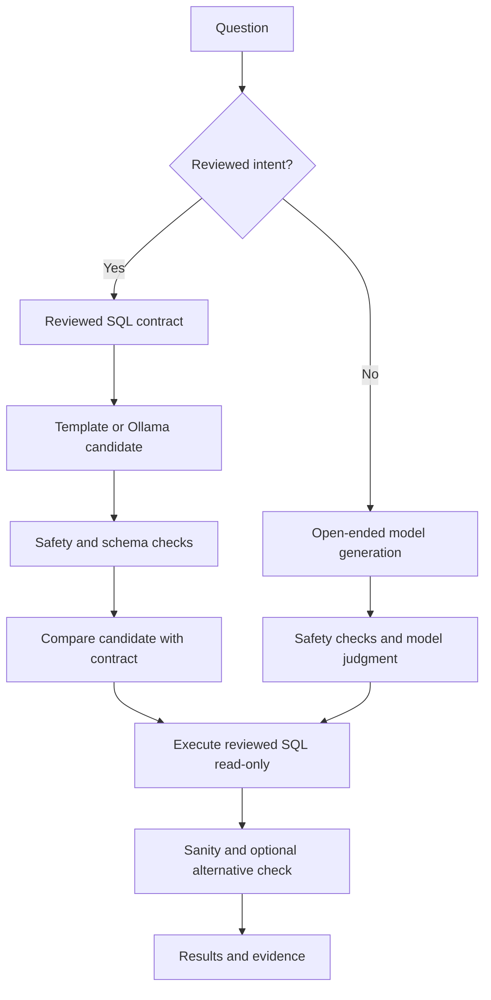
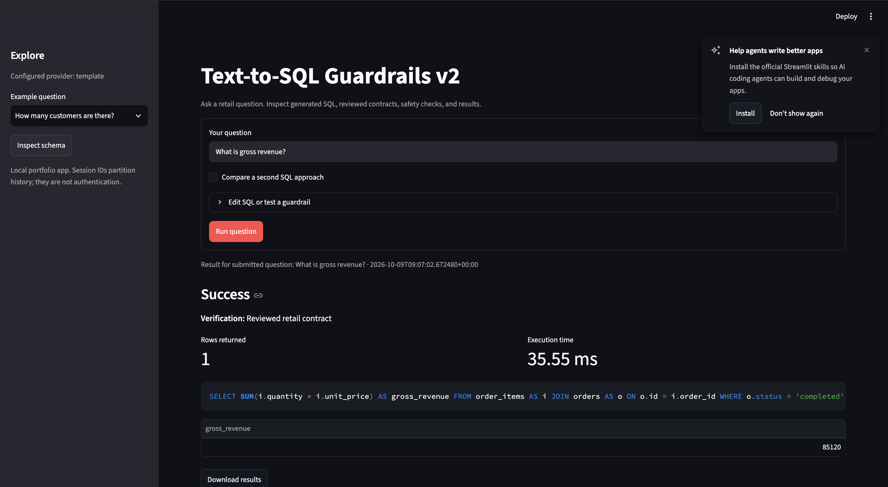
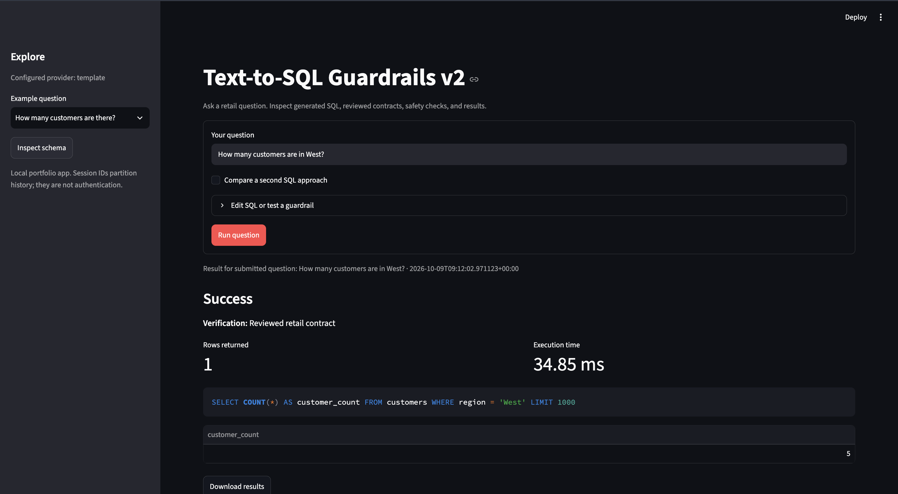
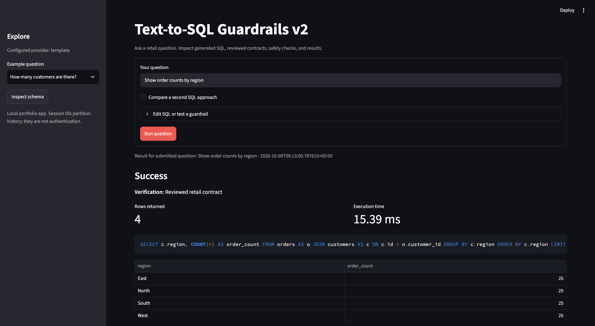
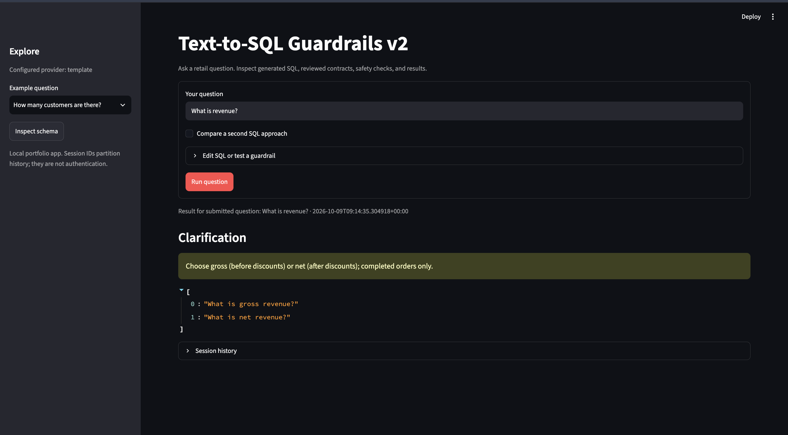
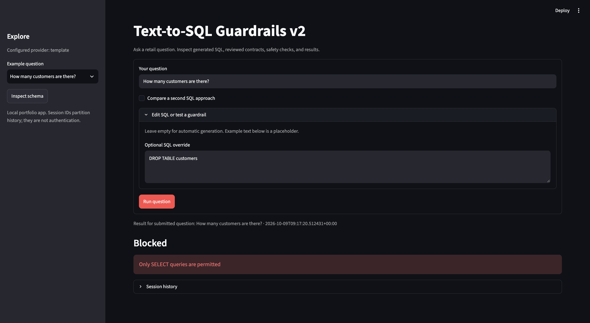
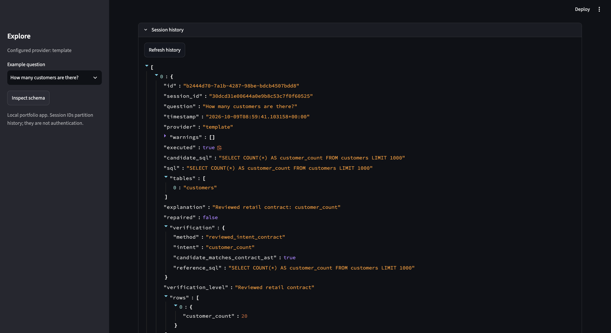

# Text-to-SQL Guardrails v2

A local retail database assistant with reviewed SQL contracts, model-output repair, SQL safety checks, read-only DuckDB execution, and inspectable validation evidence.

**Why v2 exists:** A small local model generated per-order revenue for an overall-total question and incorrectly rejected valid COUNT queries because of an outer LIMIT. This version uses deterministic contracts for supported retail questions, retains original model SQL, and refuses to present a model judgment as a calibrated correctness percentage.

## Quick start on Mac / VS Code

Extract into a new folder. Open the folder containing `requirements.txt` in VS Code.

Terminal 1:

```bash
python3 -m venv .venv
source .venv/bin/activate
python -m pip install -r requirements.txt
cp .env.example .env
python -m scripts.seed
python -m uvicorn app.main:app --reload
```

Terminal 2, in the same folder:

```bash
source .venv/bin/activate
python -m streamlit run app/dashboard.py
```

Open [dashboard](http://localhost:8501) or [API docs](http://localhost:8000/docs).

Default `MODEL_PROVIDER=template` runs the reviewed questions without any model or API key. Generation code never reads the golden evaluation dataset. The golden snapshots are a separate test oracle.

If port 8000 is already in use, stop the old Uvicorn process with Control+C in its terminal before starting v2. Stop the old Streamlit process too. Each service has its own terminal. Do not run the old and new API on the same port.

## First questions and expected answers

| Question | Expected behavior |
| --- | --- |
| How many customers are there? | One row, 20 |
| How many customers are in West? | One row, 5 |
| What is gross revenue? | One aggregate row, completed orders, no grouping |
| What is net revenue? | One aggregate row, discounts applied, completed orders |
| Show order counts by region | Four region rows |
| Show monthly order counts | Monthly breakdown |
| How many orders did customer 999 place? | One row, 0 |
| What is revenue? | Gross/net clarification |
| What is profit? | Unanswerable: cost data is absent |

Leave **Optional SQL override** empty for generation. Its example text is a placeholder. Results identify the question and timestamp that produced them. Click Run question to submit the current form.

## Workflow



Ambiguous questions clarify and unsupported template questions abstain. Unsafe generated SQL is blocked before repair. Read-only connection/transaction, disabled external access, allowed tables/functions, timeout, scan estimates, and memory/row caps form multiple layers.

## Local Ollama mode

```bash
ollama pull llama3.2:3b
```

Set `.env`:

```env
MODEL_PROVIDER=ollama
OLLAMA_MODEL=llama3.2:3b
OLLAMA_URL=http://localhost:11434
```

Restart Uvicorn after changing `.env` (the reloader watches Python files, not necessarily env files). If an old exported variable takes precedence, start explicitly:

```bash
MODEL_PROVIDER=ollama python -m uvicorn app.main:app --reload
```

Supported retail questions still generate an Ollama candidate. If its AST differs from the reviewed contract, v2 executes the reviewed SQL and records `repaired=true`, preserving `candidate_sql`. This is **contract-assisted generation**, not evidence that the model independently got the query right. Known contract results cannot be rejected by a false model judgment about LIMIT.

Open-ended questions use the LLM judge and may still be wrong, slow, unsupported by the SQL function allowlist, or flagged. They are labeled **Model judgment only; review the result**. A model cannot prove its own correctness.

Second-query comparison is optional and defaults off to reduce latency. Disagreement is visible with both result sets. For a reviewed intent, the contract result remains authoritative. For open-ended queries, disagreement flags the answer for review. Identical alternatives contribute no independent evidence.

## SQL override policy

Overrides always pass safety checks. For a reviewed intent, the override must match the reviewed SQL AST after row-limit normalization. A different but potentially equivalent query is conservatively flagged, not silently rewritten or executed. This deliberately favors predictable behavior over unrestricted power-user SQL. Aliasing differences can trigger review. Clear the override to use automatic generation.

## Tests and evaluation

```bash
python -m pytest -q
python -m scripts.evaluate --provider template
```

Read `reports/evaluation.json` and `docs/VALIDATION.md` for actual counts. Tests include correct answers, wrong metrics/filters/grouping, destructive writes, external file access, invented schema, scan/row/depth budgets, read-only execution, missing results, API history/feedback isolation, model timeout/invalid JSON, concurrency, and Streamlit startup/flagged state.

To measure live Ollama in your environment:

```bash
python -m scripts.evaluate --provider ollama --output reports/ollama-evaluation.json
```

This report records the dataset hash, original candidate exact matches, repair count, final execution matches, mutation detection, and provider/model. Do not describe repaired final accuracy as raw model accuracy. SQL exact matches may be lower for harmless syntax/order differences. Template coverage is finite; paraphrases outside the documented contracts abstain.

Golden expectations are committed and never regenerated by the evaluation command. Known semantic mutations test contract mismatch detection, not unrestricted hallucination detection. No universal safety or production-readiness claim is made.

## API

| Method | Path | Purpose |
| --- | --- | --- |
| POST | `/v1/query` | Question, optional SQL, session and alternative toggle |
| GET | `/v1/schema` | Table/column/PK/FK/sample metadata |
| GET | `/v1/history?session_id=local` | Session history |
| POST | `/v1/feedback` | Save a vote for review |
| GET | `/health` | Health status |

Feedback never automatically becomes a trusted prompt example. Incorrect answers are exported as review-required cases in `data/feedback_cases.jsonl`. Logs and private DB files are excluded by `.gitignore`.

## Docker

```bash
docker compose up --build
```

Compose provides API and dashboard backed by DuckDB. It does not provision PostgreSQL; DuckDB is the database option chosen from the reference workflow. Mac containers use `host.docker.internal` for local Ollama, which must allow the connection. Container execution is not validated in the build environment.

## Scope and known limitations

This is a GitHub portfolio project, not a deployed multi-user service. No authentication or network authorization is implemented; session IDs partition history only. The supported business domain is the seeded retail schema. New schemas require new reviewed contracts and independent expectations. Schema metadata is cached for this immutable sample DB; restart the API after changing schema. SQL allowlists can reject legitimate advanced queries.

Schema filtering uses TF-IDF vectors and FK closure, not neural embeddings. Sanity checks cover empty, NULL-heavy and negative count/revenue values, not every business range/date condition. Scan cardinalities are estimates; query interrupts and memory caps are additional bounds. Execution is serialized within one API process to reduce shared-connection risks; avoid multiple worker processes writing the audit log. Feedback requires review before promotion. Results of two queries on one dataset do not establish general semantic equivalence.

Live Ollama, macOS and Docker execution were not available for end-to-end validation during packaging. Mocked provider tests verify structured-output handling and failure states, not the actual model's accuracy.

## GitHub publishing

References: [DuckDB read-only connections](https://duckdb.org/docs/stable/clients/python/dbapi), [DuckDB security controls](https://duckdb.org/docs/stable/operations_manual/securing_duckdb/overview), [Ollama structured outputs](https://ollama.com/blog/structured-outputs).

## Demo screenshots

### Total gross revenue


### Customers in West


### Orders by region


### Ambiguity handling


### Destructive SQL blocked


### Tests and template evaluation

